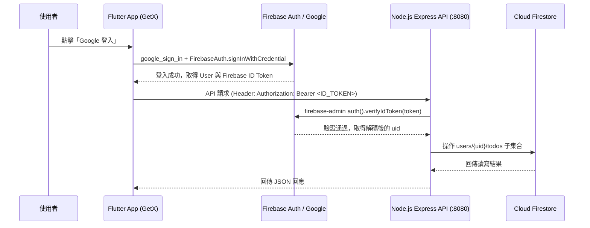

# 系統架構與技術設計書 (DESIGN.md)

## 1. 技術選型總覽 (Tech Stack)

| 層級 | 技術選型 | 說明與用途 |
| :--- | :--- | :--- |
| **開發方法論** | **TDD (測試驅動開發)** | 嚴格遵守 Red ➔ Green ➔ Refactor 循環，先寫測試並驗證失敗後才寫實作 |
| **前端框架** | **Flutter** (Dart) | 跨平台行動應用開發（支援 Android & iOS），搭配 `flutter_test` 進行 TDD |
| **前端狀態管理** | **GetX** (`get`) | 路由管理（GetPage）、依賴注入（Bindings）、響應式狀態（Rx / Obx）與 UI 彈窗（BottomSheet / Snackbar） |
| **前端身分驗證** | `firebase_core`, `firebase_auth`, `google_sign_in` | 原生 Google 登入並取得 Firebase ID Token |
| **後端語言與框架** | **Node.js** + **Express** | 高效輕量的 RESTful API 伺服器與中介軟體（Middleware）處理，搭配 Node 原生測試執行器 (`node --test`) 進行 TDD |
| **後端驗證與資料庫** | **Firebase Admin Node.js SDK** (`firebase-admin`) + **Cloud Firestore** | 驗證前端傳來的 Firebase ID Token，並直接讀寫 Firestore NoSQL 資料庫 |

---

## 2. 專案目錄結構 (Monorepo Layout)

```text
c:\Workspace\GrillMeDemo\
├── AGENTS.md                        # AI 代理通用協作規範 (含 TDD 強制規則)
├── SPEC.md                          # 功能與需求規格書
├── DESIGN.md                        # 系統架構與技術設計書
├── frontend/                        # Flutter + GetX 前端專案
│   ├── android/app/google-services.json         # Firebase Android 設定檔
│   ├── ios/Runner/GoogleService-Info.plist      # Firebase iOS 設定檔
│   ├── test/                        # 前端 TDD 單元與控制器測試
│   └── lib/
│       ├── main.dart
│       ├── app/
│       │   ├── routes/              # GetX 路由定義 (AppPages, AppRoutes)
│       │   ├── data/
│       │   │   ├── models/          # TodoModel (JSON 序列化)
│       │   │   └── providers/       # ApiProvider (自動夾帶 Bearer Token)
│       │   └── modules/
│       │       ├── auth/            # AuthController, AuthBinding, LoginView
│       │       └── todo/            # TodoController, TodoBinding, TodoListView, TodoBottomSheet
└── backend/                         # Node.js + Express 後端專案
    ├── package.json
    ├── server.js                    # 伺服器啟動入口（預設監聽 :8080）
    ├── serviceAccountKey.json       # (加入 .gitignore) Firebase Admin 私鑰憑證
    ├── src/
    │   ├── app.js                   # Express App 組裝與路由掛載（支援依賴注入以便 TDD 測試）
    │   ├── config/
    │   │   └── firebase.js          # Firebase Admin Auth & Firestore 初始化
    │   ├── middleware/
    │   │   └── auth.js              # AuthMiddleware（驗證 Authorization: Bearer <ID_TOKEN>）
    │   ├── models/
    │   │   └── todoValidator.js     # Todo 欄位與列舉驗證邏輯
    │   └── routes/
    │       └── todos.js             # Todo CRUD 路由與控制器
    └── test/
        ├── todoValidator.test.js    # 資料模型與欄位驗證 TDD 測試
        └── todos.api.test.js        # Auth 中介軟體與 Todo CRUD API 端點 TDD 測試
```

---

## 3. 身分驗證與安全架構 (Auth Flow)



* **金鑰與專案配置（已由設定檔解析）**：
  * **Firebase Project ID**：`cullio`（Project Number: `590561728933`）
  * **Android Package Name**：`com.cullio.android`（對應 `google-services.json`）
  * **iOS Bundle ID**：`com.cullio`（對應 `GoogleService-Info.plist`）
  * **iOS URL Scheme (`REVERSED_CLIENT_ID`)**：`com.googleusercontent.apps.590561728933-6cjm09g6jksp28nmmv8u3tpamjmhihef`
  * **Web OAuth Client ID (`client_type: 3`)**：`590561728933-fjn1uljkjagqhftnbjaq62btm6q8g87k.apps.googleusercontent.com`
  * **後端憑證**：透過環境變數 `GOOGLE_APPLICATION_CREDENTIALS` 或讀取 `backend/serviceAccountKey.json` 初始化 `firebase-admin`（專案 ID `cullio`）。

---

## 4. Firestore 資料模型設計 (Database Schema)

* **集合路徑**：`users/{uid}/todos/{todoId}`
* **Document 欄位結構**：

```json
{
  "id": "auto-generated-doc-id",
  "title": "完成專案規格書",
  "dueDate": "2026-11-15",
  "state": "in progress",
  "category": "company",
  "createdAt": "2026-11-11T10:50:00.000Z",
  "updatedAt": "2026-11-11T10:50:00.000Z"
}
```

* **欄位約束（Enum 驗證）**：
  * `dueDate`：驗證符合 `YYYY-MM-DD` 且為合法日曆日期。
  * `state`：僅允許 `"todo"`、`"in progress"`、`"done"`。
  * `category`：僅允許 `"company"`、`"personal"`、`"other"`。

---

## 5. 後端 RESTful API 介面定義

所有 `/api/v1/todos` 端點皆須通過 `AuthMiddleware` 驗證 `Authorization: Bearer <Firebase_ID_Token>`。

| 方法 | 路徑 | 說明 | Request Body | Response (`200` / `201`) |
| :--- | :--- | :--- | :--- | :--- |
| `GET` | `/health` | 健康檢查（免驗證） | 無 | `{"status": "ok"}` |
| `GET` | `/api/v1/todos` | 取得當前使用者的所有 Todo | 無 | `{"data": [Todo, ...]}` |
| `POST` | `/api/v1/todos` | 新增一筆 Todo | `{"title", "dueDate", "state", "category"}` | `{"data": Todo}` |
| `PUT` | `/api/v1/todos/:id` | 更新指定 Todo（含狀態切換或編輯） | `{"title", "dueDate", "state", "category"}` | `{"data": Todo}` |
| `DELETE` | `/api/v1/todos/:id` | 刪除指定 Todo | 無 | `{"message": "deleted"}` |
